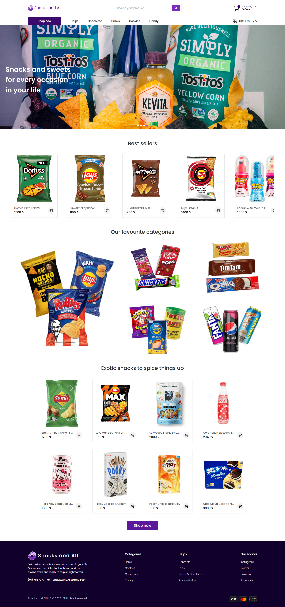
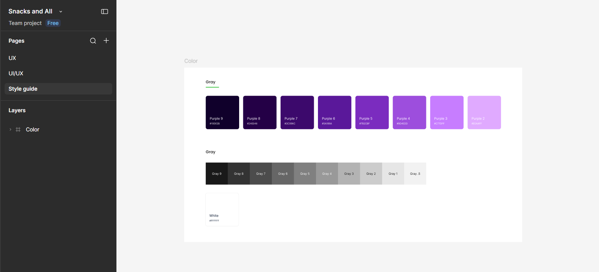
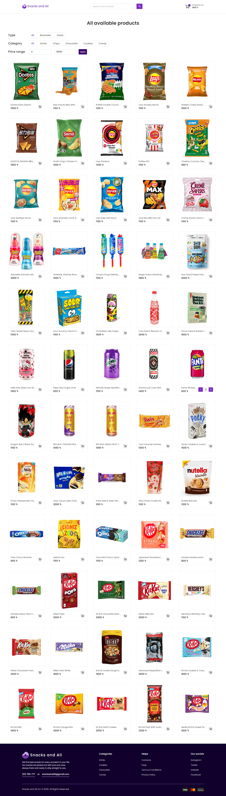
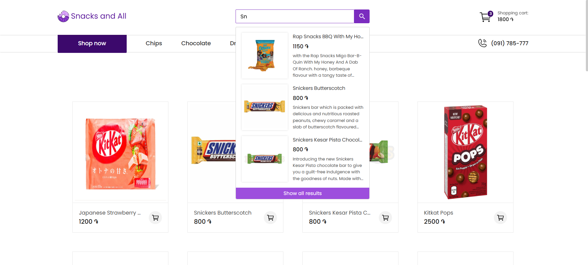
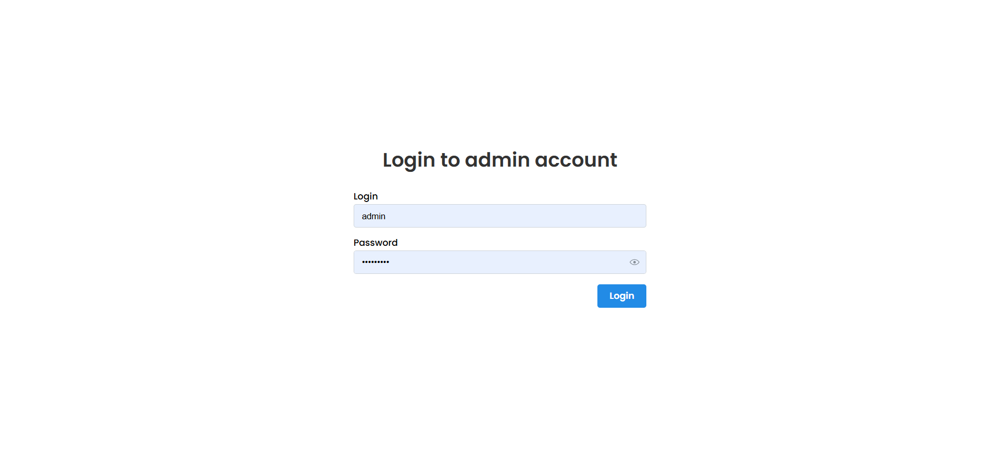
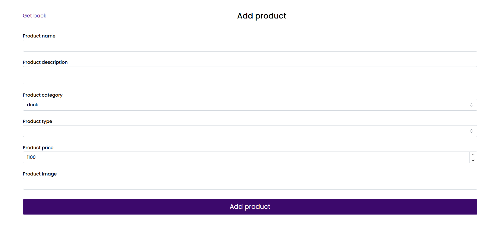
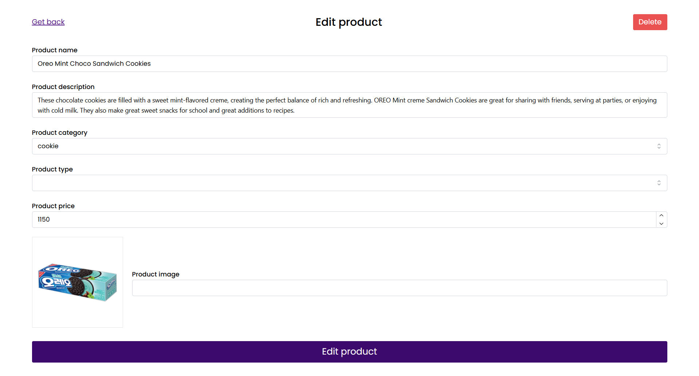

# 🍩 Snacks and All

**An online snack shop where you can browse, fill a cart and place an order, no account needed.**

Built as my college diploma project (2024). **I designed it from scratch** (UX, UI and style guide in Figma) **and then built it in code.** This repository is the **website (client)**. The small server behind it lives here: **[Snacks-and-All_Api](https://github.com/selderer/Snacks-and-All_Api)**.

🔗 **[Live demo](https://selderer.github.io/Snacks-and-All-Client/)** · 🎨 **[Figma design](https://www.figma.com/design/58O13LCNhqwttjIzSQmPg0/Snacks-and-All?node-id=0-1&t=vtbNRfRImjW0bvlE-1)**



---

## 🎨 Design process

Before writing any code, I designed the whole project myself in **Figma**. The file has three pages:

| Page | What's inside |
|---|---|
| **UX** | User flows and structure: how a visitor gets from the homepage to a finished order without an account |
| **UI/UX** | Full page designs and reusable **components with their states** |
| **Style guide** | A **custom style guide**: colour palette so every page looks like part of the same brand |

**The brand look:** a deep-purple palette (8 shades from `#10002B` to `#E0AAFF`) with a neutral gray scale and white. It gives the shop a playful but clean feel, and the shades are used consistently for buttons, the footer, hover states and highlights.



👉 **[Open the full design in Figma](https://www.figma.com/design/58O13LCNhqwttjIzSQmPg0/Snacks-and-All?node-id=0-1&t=vtbNRfRImjW0bvlE-1)**

---

## ✨ What can you do on the site?

| | |
|---|---|
| 🛍️ **Browse** | Snacks sorted into 5 categories: Chips, Chocolate, Drinks, Cookies and Candy |
| 🔎 **Search** | Type a few letters and get instant suggestions with photo, price and description |
| 🎚️ **Filter** | Narrow products by type (Bestseller / Exotic), category and price range |
| 🛒 **Cart** | Add items, change quantities right on the product card, remove items or clear the cart. The total updates live |
| 💳 **Checkout** | Two simple steps: delivery details, then card details. **No sign-up required** |
| 🔐 **Admin panel** | A password-protected page where the shop owner can add new products and edit existing ones |

---

## 📸 Screenshots

### Home page
Slideshow banner, best sellers, favourite categories and a hand-picked "Exotic snacks" section.


### All products, with filters


### Category page (Drinks)
Products in the selected Category page.


### Live search


### Shopping cart


### Checkout (2 steps)
| Step 1: Delivery details | Step 2: Card details |
|---|---|
|  |  |

### Admin login


### Admin adding product


### Admin editing or deleting product


---

## 🧰 Tech stack

**Design**
- **Figma**: UX flows, UI screens, component states and a custom style guide

**Client (this repo)**
- **React 18**: the main framework
- **React Router**: navigation between pages
- **Mantine**: ready-made UI components and form handling
- **Axios**: talking to the API
- **Swiper**: homepage slideshow and product carousel
- **Tabler Icons**: icons
- Pixel-matched to my own **Figma design**
- Hosted on **GitHub Pages**

**Server ([separate repo](https://github.com/selderer/Snacks-and-All_Api))**
- **Node.js + Express**: the API
- **MySQL**: stores products and admin data
- **JWT + bcrypt**: secure admin login (tokens and hashed passwords)
- **Multer**: product image uploads

---

## 🏗️ How it fits together

```
 Customer / Admin  ──►  React website (this repo)  ──►  Node.js API  ──►  MySQL database
                                                       (Snacks-and-All_Api)
```

The website shows the shop and sends requests to the API. The API reads and writes products in the database and checks admin logins.

> **Note:** the API is a small project, but it shows my first hands-on experience with Node.js, Express and databases.

---

## 🚀 Run it locally

You need [Node.js](https://nodejs.org/) installed.

```bash
# 1. Clone and install
git clone https://github.com/selderer/Snacks-and-All-Client.git
cd Snacks-and-All-Client
npm install

# 2. Start the website
npm start
```

The site opens at `http://localhost:3000`.

To see real products, you also need to run the API. Setup steps are in the [API repository](https://github.com/selderer/Snacks-and-All_Api).

---

## 📝 Good to know

- This is a **portfolio / diploma project**, so no real payments are processed and no real orders are shipped.
- The product photos and descriptions belong to their respective brands and are used for demonstration only.

---

## 👤 Author

**selderer**: [GitHub profile](https://github.com/selderer) · [Figma design](https://www.figma.com/design/58O13LCNhqwttjIzSQmPg0/Snacks-and-All?node-id=0-1&t=vtbNRfRImjW0bvlE-1)
